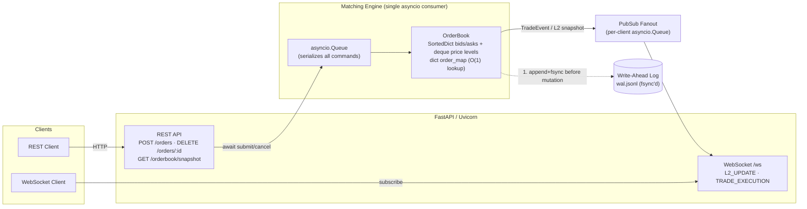
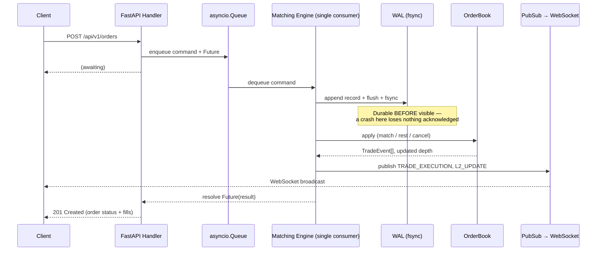
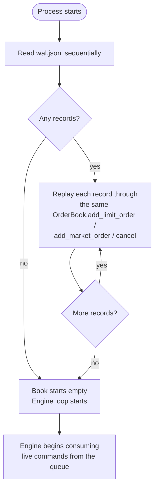

# LOB — Limit Order Book & Matching Engine

A production-shaped, high-throughput Limit Order Book and price-time-priority
matching engine in pure Python 3.11+, with crash-safe Write-Ahead Log
persistence and a real-time FastAPI REST + WebSocket gateway.

Built as a systems-level demonstration: deterministic single-writer order
processing, O(log n) price-level operations, O(1) cancellation, and
event-sourced crash recovery — the same primitives that underpin real
exchange matching engines, scaled down to something you can read end to end.

## Why this exists

Most "order book" toy projects stop at a dict of orders and a naive O(n)
scan for matching. This one instead makes the deliberate engineering
tradeoffs a real matching engine has to make:

- **Deterministic single-writer concurrency** instead of locking a shared
  data structure from multiple threads.
- **Event-sourced persistence** (log inputs, replay them) instead of
  snapshotting complex mutable state.
- **Backpressure-safe fanout** so a slow WebSocket client can never stall
  the matching hot path.
- **Measured, not assumed, performance** — the benchmark suite reports
  real p50/p90/p99 latency at increasing book depth, not a marketing claim.

## Architecture



**Single-writer model.** Every order/cancel request funnels through one
`asyncio.Queue` consumed by exactly one coroutine (`MatchingEngine._run`).
Concurrent API handlers can `await` submission from many simultaneous
requests, but the `OrderBook` itself is only ever mutated by one coroutine
at a time — so matching is lock-free *and* deterministic: given the same
input sequence, the resulting trades and book state are always identical.

## Order submission flow



## Crash recovery (WAL replay)

Rather than persisting matching *output* (trades, book snapshots), the WAL
persists matching *input* — the exact order/cancel commands, in submission
order. Matching is a pure, deterministic function of
`(order book state, input sequence)`, so replaying the same input sequence
through the same matching code reconstructs the exact same book state and
regenerates the exact same trades. No separate snapshot format, no
drift between what was logged and what was applied.



## Data structures & complexity

| Structure | Purpose | Complexity |
|---|---|---|
| `SortedDict[int, deque[Order]]` (bids, asks) | Price level index | O(log n) insert/delete of a price level; O(1) FIFO append/pop within a level |
| `dict[order_id, Order]` (`order_map`) | Cancel / lookup by id | O(1) |
| `deque[Order]` per price level | FIFO time priority at a price | O(1) append/popleft |
| `Order` (`@dataclass(slots=True, eq=False)`) | Order record | No per-instance `__dict__`; identity-based equality for cheap `deque.remove()` |

Bids and asks both live in ascending-sorted `SortedDict`s. Asks are
naturally best-first ascending (`asks.peekitem(0)` = lowest ask = best).
Bids read best-first from the *other end* of the same structure
(`bids.peekitem(-1)` = highest bid = best) — one comparator, two views,
instead of maintaining a second descending structure.

## Project layout

```
.
├── src/lob/
│   ├── models.py           # Order, TradeEvent, Side/OrderType/OrderStatus enums
│   ├── order_book.py       # OrderBook: matching core, cancel, L2 snapshot
│   ├── matching_engine.py  # Single-writer actor: queue, WAL-before-apply, pubsub fanout
│   ├── wal.py               # Append-only, fsync'd Write-Ahead Log + replay
│   ├── pubsub.py             # In-memory pub/sub fanout for WebSocket broadcast
│   ├── config.py             # Env-var-driven settings
│   └── api/
│       ├── main.py           # FastAPI app factory, REST + WebSocket routes
│       └── schemas.py        # Pydantic request/response models
├── benches/benchmark_matching.py   # p50/p90/p99 latency vs. book depth
├── scripts/loadgen.py              # Async load generator (target orders/sec)
├── tests/                           # order book, WAL, engine, API integration tests
└── data/                            # wal.jsonl written here at runtime (gitignored)
```

## Quickstart

Requires Python 3.11+.

```bash
python -m venv .venv
source .venv/bin/activate
pip install -e ".[dev]"

# run the API server
uvicorn lob.api.main:app --reload

# in another shell: submit an order
curl -X POST localhost:8000/api/v1/orders \
  -H "Content-Type: application/json" \
  -d '{"trader_id":"alice","side":"SELL","order_type":"LIMIT","price":10050,"qty":10}'

# submit a crossing order and see it fill
curl -X POST localhost:8000/api/v1/orders \
  -H "Content-Type: application/json" \
  -d '{"trader_id":"bob","side":"BUY","order_type":"LIMIT","price":10050,"qty":10}'

# inspect L2 depth
curl localhost:8000/api/v1/orderbook/snapshot

# cancel an order
curl -X DELETE localhost:8000/api/v1/orders/<order_id>

# stream live trades / depth updates
websocat ws://localhost:8000/ws   # or any WebSocket client
```

Prices are integer ticks/cents throughout (`10050` = $100.50) — the engine
never touches floating point, avoiding binary rounding error on the hot path.

### Crash recovery in action

```bash
uvicorn lob.api.main:app          # submit a few orders, then Ctrl+C mid-session
uvicorn lob.api.main:app          # restart — GET /api/v1/orderbook/snapshot
                                   # shows the exact same depth as before the kill
```

## Testing

```bash
pytest -v
```

Covers: price-time priority and FIFO-at-a-price matching, partial fills,
market order sweeps and liquidity exhaustion, O(1) cancellation, WAL
append/replay ordering, full engine crash-recovery (kill and restart against
the same WAL file, assert identical book state), and REST API integration
tests via `httpx.ASGITransport` (no running server required).

## Benchmarking

```bash
python benches/benchmark_matching.py
```

Measures p50/p90/p99/max latency (microseconds) for three core operations
— resting insert, crossing match, cancel — at book depths from 1,000 to
50,000 live resting orders, isolated from network/ASGI/WAL overhead so the
numbers reflect the `OrderBook` matching core itself.

Measured results (5,000 iterations/op, Python 3.11.16, single core, WSL2):

| Depth | Operation | p50 (µs) | p90 (µs) | p99 (µs) |
|---:|---|---:|---:|---:|
| 1,000 | resting insert | 4.20 | 7.30 | 15.60 |
| 1,000 | crossing match | 12.00 | 13.00 | 34.10 |
| 1,000 | cancel | 3.50 | 5.90 | 10.00 |
| 5,000 | resting insert | 3.80 | 6.70 | 32.00 |
| 5,000 | crossing match | 12.10 | 17.90 | 96.40 |
| 5,000 | cancel | 3.40 | 6.00 | 10.10 |
| 10,000 | resting insert | 4.00 | 5.40 | 21.20 |
| 10,000 | crossing match | 4.90 | 9.30 | 16.40 |
| 10,000 | cancel | 1.50 | 3.40 | 7.10 |
| 25,000 | resting insert | 2.40 | 2.80 | 4.70 |
| 25,000 | crossing match | 7.80 | 9.60 | 24.10 |
| 25,000 | cancel | 3.40 | 4.60 | 18.30 |
| 50,000 | resting insert | 4.10 | 5.30 | 15.10 |
| 50,000 | crossing match | 5.10 | 10.10 | 22.40 |
| 50,000 | cancel | 3.20 | 4.30 | 5.90 |

p50 latency stays in the low single-digit microseconds across the full
1,000→50,000 depth range for all three operations, confirming the O(log n)
`SortedDict` price-level cost and O(1) `dict`/`deque` cost dominate over
book size in practice. Full run: `python benches/benchmark_matching.py`.

## Load testing

With the server running:

```bash
python scripts/loadgen.py --url http://localhost:8000 --rate 1000 --concurrency 50 --duration 10
```

Async `httpx`-based generator that fans out concurrent workers to hit a
target aggregate orders/sec and reports achieved throughput and error rate.

## Design notes & tradeoffs

- **Why log inputs, not outputs, for the WAL.** Logging trades would
  require the replay path to *trust* a second, independently-produced data
  format instead of re-deriving state through the one matching
  implementation that's actually tested. Logging inputs means recovery
  literally cannot drift from live behavior — they're the same code path.
- **`fsync` on every write.** Guarantees an acknowledged order is never
  lost, at the cost of one syscall per order on the hot path. This is the
  correct default for a system whose entire purpose is not losing orders;
  a real deployment could relax to periodic fsync with a bounded
  acknowledged-but-unpersisted window if the latency/durability tradeoff
  called for it.
- **Single asyncio consumer instead of per-order locking.** Removes all
  need for fine-grained locks around the book, at the cost of bounding
  engine throughput to one core. For higher throughput, the natural next
  step is sharding independent `MatchingEngine` instances by symbol (see
  below), not adding locks to this one.
- **Market order remainder is dropped, not rested.** Matches standard
  exchange semantics — a market order takes available liquidity
  immediately and does not become a standing resting order.

## Possible extensions

- Multi-symbol support: one `MatchingEngine` (queue + book + WAL) per
  symbol, trivially parallel since engines never share state.
- WAL log compaction / periodic snapshotting so replay time doesn't grow
  unbounded with total historical order count.
- Stop, iceberg, and time-in-force (`IOC`, `FOK`, `GTC`) order types.
- A `uvloop` event loop policy and/or a Cython/Rust extension for the
  `_match` inner loop if profiling shows it as the throughput ceiling.
- FIX protocol gateway alongside the REST/WebSocket API.

## License

MIT
